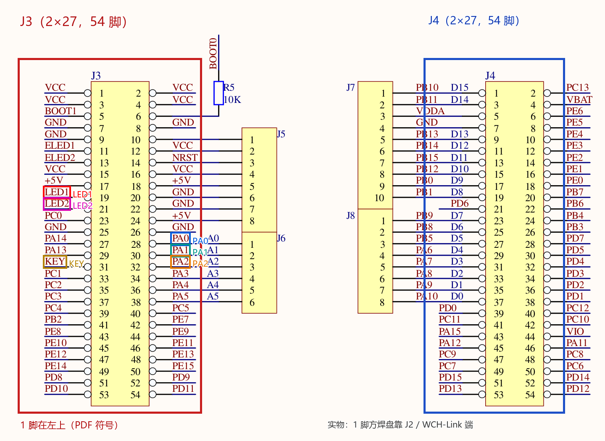
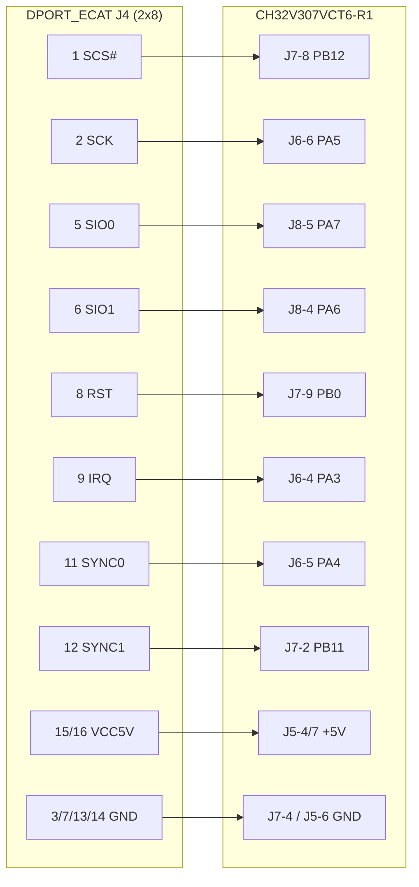
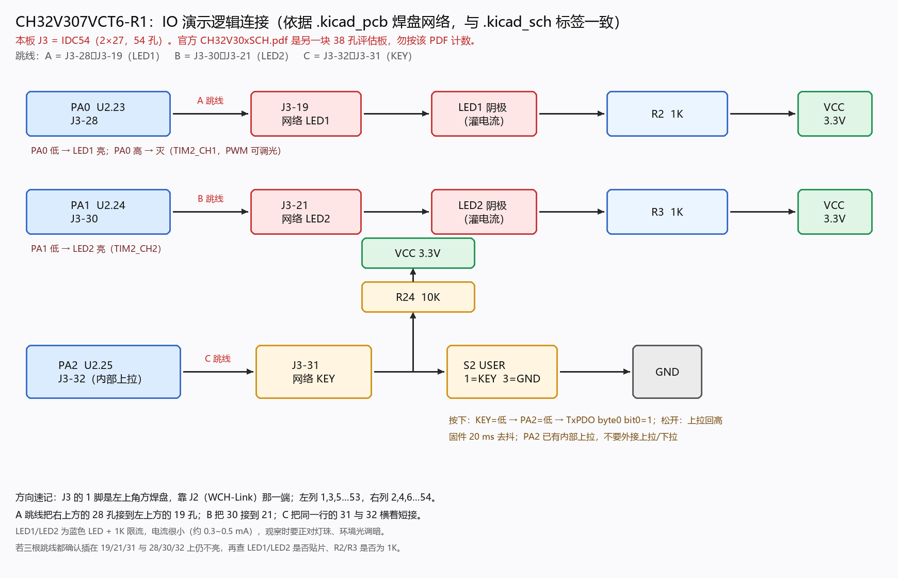
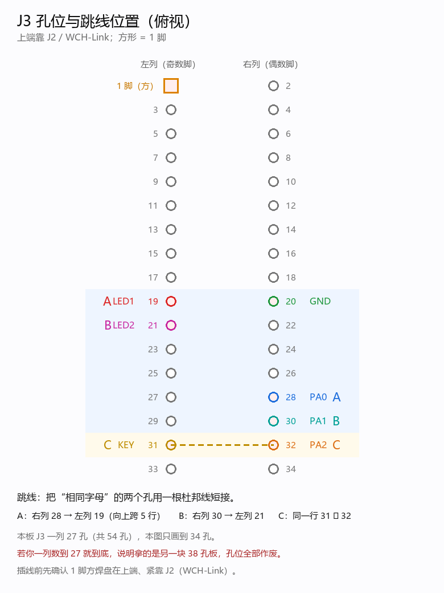
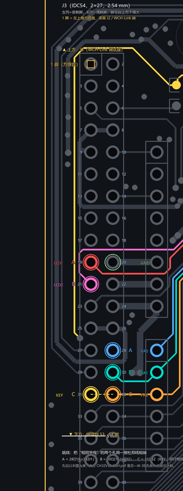
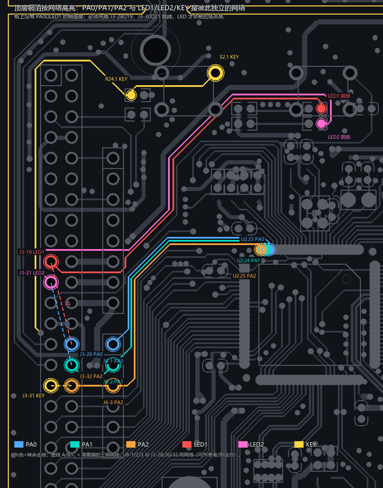
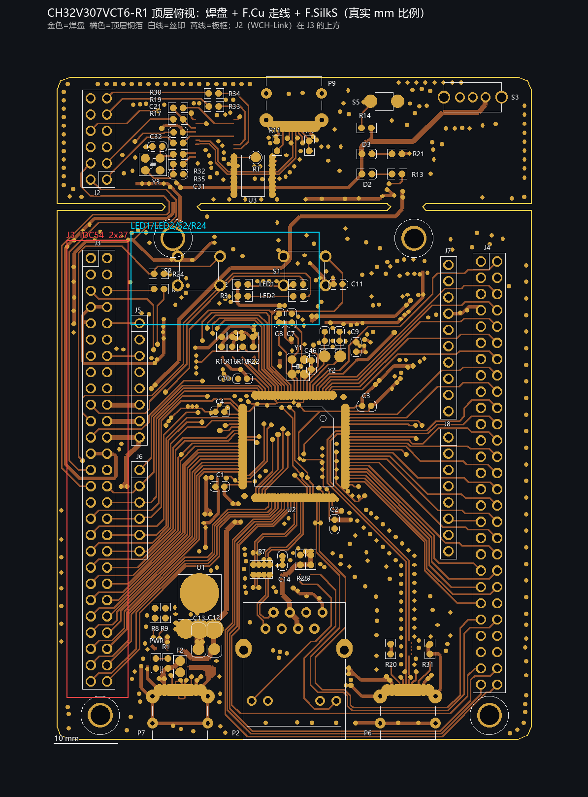

# 硬件接线指导：E252 DPORT_ECAT ↔ CH32V307VCT6 EVT

本文给出 **SYS-E252 DPORT_ECAT 模块**与 **CH32V307VCT6-R1 评估板**之间的杜邦线接线方案。按本文接线可在不改板、不换芯片的前提下复现仓库固件的运行条件。

- 适用板卡：DPORT_ECAT（E252 ESC，QMX102 载板）V2.2；CH32V307VCT6-R1（1v1）评估板
- 原理图：[E252_DPORT_ESC_QMX102_V2.2_20260427.pdf](E252_DPORT_ESC_QMX102_V2.2_20260427.pdf)、[CH32V307VCT6-R1-1v1-SCH.pdf](CH32V307VCT6-R1-1v1-SCH.pdf)
- 固件引脚定义以 `src/` 中的 `board_config.h` 为准；本文与之一致
- 接线状态：SPI1 + DMA @24 MHz，从站可进 OP

> **安全边界**：E252 的 SPI、IRQ、SYNC、RST 信号脚**只耐受 3.3 V**。5 V 只能接 DPORT J4 的 pin 15/16；把 5 V 接到任何信号脚都会损坏模块。

---

## 1. 需要的器材

| 项目 | 数量 | 说明 |
|---|---|---|
| E252 DPORT_ECAT 模块 | 1 | 板载 E252 ESC、25 MHz 晶振、网络变压器、128 Kbit EEPROM、双 RJ45 |
| CH32V307VCT6-R1 EVT 板 | 1 | 板载 WCH-LinkE，调试串口 115200 8N1 |
| 杜邦线（母-母） | 10–12 根 | 建议 ≤10 cm；至少 2 根地线 |
| 5 V 电源 | 1 | 可由 EVT J5-4/J5-7 取电，也可用 DPORT 自身电源座 |
| 网线 | 1–2 根 | 主站网卡 ↔ DPORT 任一 RJ45 |

---

## 2. DPORT_ECAT 主接口 J4（2×8，2.54 mm）

J4 是模块与 MCU 的唯一主接口；J3（2×2）为 LED/EEPROM 配置等辅助信号，**本方案不接**。

| J4 pin | 信号 | 方向（相对 DPORT） | 本方案用途 |
|---|---|---|---|
| 1 | D5/SCS# | 输入 | SPI 片选，低有效 |
| 2 | D9/SCK | 输入 | SPI 时钟 |
| 3、4、7、13、14 | GND | — | 共地（至少接 1 根，建议 2 根） |
| 5 | D0/SIO0 | 输入 | SPI MOSI（主机 → E252） |
| 6 | D1/SIO1 | 输出 | SPI MISO（E252 → 主机） |
| 8 | RST | 输入 | ESC 复位（经板上 R54 0 Ω 进芯片） |
| 9 | IRQ | 输出 | AL/SM 事件中断 → MCU EXTI |
| 10 | EBUSY_LOADED | 输出 | 板上悬空，不接 |
| 11 | SYNC/LATCH0 | 输出 | DC SYNC0 |
| 12 | SYNC/LATCH1 | 输出 | DC SYNC1 |
| 15、16 | VCC5V | 电源输入 | 模块内置 3.3 V LDO，**只接 5 V** |

### J4 物理方向判定

原理图只给出电气脚号，双排实物中“哪一排是奇数脚、pin 1 在哪端”需按实物确认。方向约定：

- pin 1/2 端靠近 J3 辅助信号座，pin 15/16 端靠近板载电源稳压器（LDO）
- 8 列双排中，**上下两脚都是 GND 的列**有两列：3/4 列与 13/14 列
- 快速判定：全 GND 列两侧若是 CS#/CLK 与 MOSI/MISO，则该列为 3/4 列，CS#/CLK 一侧即 pin 1 端；若两侧是 SYNC0/1 与 5 V，则该列为 13/14 列，5 V 一侧即 pin 15/16 端
- 旁证：pin 15/16 与 LDO 输入端导通；GND 脚与 RJ45 金属壳导通

上电前务必用万用表确认 5 V 与任意信号脚之间无短路。

---

## 3. CH32V307VCT6-R1 侧接点

EVT 板有 J3/J4 两组 2×27 长排针，以及 J5(1×8)、J6(1×6)、J7(1×10)、J8(1×8) 单排针。J7 引出了 SPI2 的 PB13/PB14/PB15 以及 PB11/PB12/PB0；SPI1 的 PA5/PA6/PA7 则分散在 J6/J8 上。

**所有排针的 pin 1 都在靠近 J2（WCH-Link 调试座 / USB）的一端，实物 pin 1 焊盘为方形。** 数错方向是最常见的接线错误，接前先做一次通断自检。

> 厂商合订本 `CH32V30xSCH.pdf` 里混有多块 38 引脚评估板的图纸，**不能按它数 J3**。本仓库归档的 CH32V307VCT6-R1 单板页（J3/J4 为 2×27）与实物一致。

本方案用到的接点：

| 接点 | 网络 | 说明 |
|---|---|---|
| J6-4 | PA3 | E252 IRQ → EXTI3 |
| J6-5 | PA4 | E252 SYNC0 → EXTI4 |
| J6-6 | PA5 | SPI1_SCK |
| J7-2 | PB11 | E252 SYNC1 → EXTI11 |
| J7-4 | GND | 地 |
| J7-8 | PB12 | SPI 软件片选 |
| J7-9 | PB0 | E252 RST |
| J8-4 | PA6 | SPI1_MISO |
| J8-5 | PA7 | SPI1_MOSI |
| J5-4 或 J5-7 | +5 V | 给 DPORT 供电（两脚同为 +5 V） |
| J5-5 或 J5-6 | GND | 地 |

> **禁止**：J5-1 / J5-3 是 3.3 V VCC，**不能**接 DPORT 的 VCC5V 脚；J5-2 是 NRST；J4 的 47–50 脚是以太网差分对（ETXN/ETXP/ERXN/ERXP），不要占用；J2 是 WCH-Link 调试座。

---

## 4. 接线表

共 9 根必接 + 2 根可选（SYNC0/SYNC1）。

| # | DPORT J4 | 方向 | CH32V307 EVT | 信号 | 备注 |
|---|---|---|---|---|---|
| 1 | pin 1（D5/SCS#） | → | J7-8（PB12） | SPI 片选 | 软件 CS，全程保持低 |
| 2 | pin 2（D9/SCK） | → | J6-6（PA5） | SPI1_SCK | 时钟 |
| 3 | pin 5（D0/SIO0） | → | J8-5（PA7） | SPI1_MOSI | 主出从入 |
| 4 | pin 6（D1/SIO1） | ← | J8-4（PA6） | SPI1_MISO | 主入从出 |
| 5 | pin 9（IRQ） | ← | J6-4（PA3） | EXTI3 | AL/SM 事件 |
| 6 | pin 11（SYNC0） | ← | J6-5（PA4） | EXTI4 | 不用 DC 时可不接，建议接 |
| 7 | pin 12（SYNC1） | ← | J7-2（PB11） | EXTI11 | DC SYNC1 |
| 8 | pin 8（RST） | ← | J7-9（PB0） | GPIO 开漏 + 上拉 | 拉低复位 ESC |
| 9 | pin 15/16（VCC5V） | — | J5-4 或 J5-7（+5 V） | 供电 | **只接 5 V** |
| 10 | pin 3/7/13/14（GND） | — | J7-4 或 J5-6（GND） | 共地 | 建议 2 根 |
| — | J3 辅助信号 | — | 不接 | — | 不影响通信 |

---

## 5. 为什么这样接

### 5.1 SPI 用 SPI1（PA5/PA6/PA7）而不是 SPI2

| 维度 | SPI2 | SPI1 |
|---|---|---|
| 总线 | APB1，PCLK1 = 48 MHz | APB2，PCLK2 = 96 MHz |
| 最高 SCK（/2） | 24 MHz | 48 MHz（受 E252 读上限约束，实际不用） |
| 本方案配置 | — | /4 = 24 MHz + DMA |
| 单次 AL 事件读 | 17 µs | 16 µs |

SPI1 的寄存器与 DMA 通道挂在 96 MHz 的 APB2 上，同样 24 MHz 位率下每笔事务少约 1 µs。选择 24 MHz 而不是更高，是因为 E252 的 `READ (0x03)` 规格上限为 30 MHz，而 28 MHz 起就读错（详见 §6）。

### 5.2 片选用软件 GPIO（PB12），不用 SPI1 硬件 NSS（PA4）

- PA4 已分配给 SYNC0（DPORT J4-11），DC 需要它；
- 一次 ESC 事务包含“命令 + 忙轮询 + 数据”三段，必须由软件在整个事务期间保持 CS 低；硬件 NSS 跟随 SPI 使能，无法覆盖忙轮询，且 CH32V307 的 SPI 章节没有可编程 NSS 脉冲（NSSP）；
- CS 固定为 PB12，与 SPI 实例无关：若使用 SPI2，CS 线不用动。

### 5.3 SYNC1 用 PB11（EXTI11）

SPI1 默认映射占用 PA5，因此 SYNC1 改到 PB11。PB11 的复用功能为 TIM2_CH4 / I2C2_SDA / USART3_TX；本工程未使用 I2C2 与 USART3，PB11 在 PCB 上只连 MCU 与 J7-2（并联 J4-3），无冲突。用 EXTI11 直接进 NVIC，ISR 内读 TIM2 计数即可得到 10.4 ns 分辨率的时间戳。

### 5.4 其余信号

- IRQ=PA3（EXTI3）、SYNC0=PA4（EXTI4）、RST=PB0、UART=PA9/PA10（USART1 → 板载 WCH-LinkE 串口）、LED1=PA0、LED2=PA1、KEY=PA2。这些引脚与 SPI1、SYNC1 无复用冲突。
- LED/KEY 在 EVT 板上并非出厂直连 MCU，需要 J3 上的 A/B/C 三组跳线（见 §7）。

---

## 6. 飞线与信号质量

杜邦线不是受控阻抗传输线，会直接吃掉 SPI 的时序余量：

- E252 [手册](../thm/E252_EtherCAT_Controller_Manual.pdf) 要求 SCK 下降沿到 MISO 有效 `tV ≤ 11 ns`（30 pF 负载）。飞线链路的有效延迟约 **15.6–17.9 ns**，比规格多 5–7 ns。
- 因此读时钟上限取 24 MHz：24 MHz 稳定；**28 MHz 起失败**，32/36/40/48 MHz 同样失败。失败表现为整帧均匀右移 1 位（`BYTE_TEST` 由 `0x87654321` 读成 `0xC3B2A190`）。
- 已排除 CS 建立/保持、CPOL/CPHA、CH32 的 HSRXEN 位等因素；飞线是余量损失的主要来源，但不是“24 MHz 能否用”的决定因素——降到 24 MHz 后所有指标正常。
- 实践建议：
  - 线长 ≤10 cm，SCK/MOSI/MISO 尽量短且并排走；
  - 至少 2 根地线，地线尽量靠近 SCK；
  - 远离 RJ45 差分对与开关电源走线；
  - 若现场出现偶发读错，先把 SPI 降到 16 MHz 确认链路，再逐步提高；
  - 不建议在飞线条件下追求 30 MHz 规格上限。

---

## 7. 用户 LED / 按键跳线（A/B/C）

EVT 板的 LED1/LED2/KEY 与 MCU 之间没有出厂连接，必须在 J3 上用杜邦线短接三组“同字母”孔位。**不接跳线不影响 EtherCAT 通信**，只影响面板指示与按键。

| 跳线 | 连接 | 网络 | 效果 |
|---|---|---|---|
| A | J3-19 ↔ J3-28 | LED1 → PA0 | PA0 低电平点亮 LED1，高电平熄灭；TIM2_CH1 可 PWM |
| B | J3-21 ↔ J3-30 | LED2 → PA1 | PA1 低电平点亮 LED2；TIM2_CH2 可 PWM |
| C | J3-31 ↔ J3-32 | KEY → PA2 | 松开为高、按下为低；固件 20 ms 去抖 |

补充说明：

- LED 为蓝色 LED，串联 1 kΩ 限流电阻，工作电流约 0.3–0.5 mA，属正常可见亮度。
- PA2 在 MCU 内部已有上拉，外部 R24=10 kΩ 上拉，**不要再加外部上拉/下拉**。
- J3 的 pin 1 在上端、靠近 J2（WCH-Link）；若数到 27 就到底，说明手里是另一块 38 引脚评估板，孔位定义不适用。

---

## 8. 接线前自检（断电，万用表蜂鸣档）

1. **方向自检**
   - EVT：J7-1 ↔ J4-1 应导通（同为 PB10）；J7-4 ↔ J5-6 应导通（同为 GND）。不导通说明数反了。
   - DPORT：按 §2 的全 GND 列法确认 pin 1 端与 5 V 端。
2. **逐脚连通性**（每根线只应通到目标脚）

| DPORT 脚 | 信号 | 应导通 | 重点确认“不通” |
|---|---|---|---|
| 1 | CS# | J7-8（PB12） | J7-5/6/7/9、J6-4、J5-4 |
| 2 | SCK | J6-6（PA5） | J7-5/6/7/8/9、J6-4、J5-4 |
| 5 | MOSI | J8-5（PA7） | J8-4、J7-8/9、J6-4 |
| 6 | MISO | J8-4（PA6） | J8-5、J7-8/9、J6-4 |
| 9 | IRQ | J6-4（PA3） | J6-5/6、J7-2/8、J5-4 |
| 11 | SYNC0 | J6-5（PA4） | J6-4/6、J7-2/8、J5-4 |
| 12 | SYNC1 | J7-2（PB11） | J6-4/5/6、J7-8/9、J5-4 |
| 8 | RST | J7-9（PB0） | J7-5/6/7/8、J6-4 |
| 15/16 | VCC5V | J5-4 或 J5-7 | 所有信号脚、GND |
| 3/7/13/14 | GND | J7-4 | 所有信号脚、+5 V |

判读：某信号脚对两个 EVT 点都蜂鸣 → 两根线接反；对谁都不响 → 线断/未插到位；5 V 对任意信号脚蜂鸣 → 立即断开排查。

3. **上电顺序**：断电接好全部线 → 复查 5 V 与信号脚无短路 → 先共地 → 信号 → 最后 5 V。

---

## 9. 改线注意点

- **使用 SPI2**：需同时做三件事，缺一不可——
  1. 三根 SPI 线接到 SCK=J7-5(PB13)、MISO=J7-6(PB14)、MOSI=J7-7(PB15)；
  2. `E252_SPI_USE_SPI1` 置 0，`E252_SPI_PRESCALER` 取 `SPI_BaudRatePrescaler_2`（否则 SPI2 只有 12 MHz）；
  3. SYNC1 接到 PA5（J6-6），并同步修改 `E252_SYNC1_*` 宏。
- **不要用 PA4 作硬件 NSS**：PA4 是 SYNC0；若 DC 要用 SYNC0，硬件 NSS 方案不可行。
- **不要占用调试口**：PA13/PA14/PA15、PB3/PB4 是 SWD/JTAG，占用后无法烧录/调试。
- **不要给 DPORT 喂 3.3 V**：J5-1/3 是 3.3 V，接错会绕过模块 LDO；DPORT 只接受 J4-15/16 的 5 V。
- **SYNC0/SYNC1 未激活时为静止高电平**，不要把它当成故障；激活后为低有效脉冲（本工程 1 ms 周期、约 100 µs 脉宽）。
- **热插拔风险**：所有接线在断电状态下完成；上电后不要插拔 J4 排线。

---

## 10. 接好之后

- 上电：DPORT 板载电源指示灯常亮；CH32 串口 115200 输出启动信息与 `[E252] HW_Init=0 selftest=0 BYTE_TEST=0x87654321`。
- 自检失败时先查：5 V 是否到位、共地是否可靠、CS/SCK/MOSI/MISO 是否与表中脚位一一对应。
- 编译、烧录与主站联调见 [../build.md](../build.md) 与 [../performance.md](../performance.md)。
